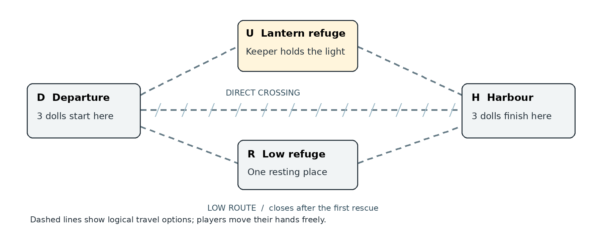

# Handover — Final development specification

> Source: `Handover_Full_Development_Document_v3.0.docx` (in this folder), converted to Markdown so it can be read and searched in the repository. The .docx remains the authoritative copy; if the two ever disagree, the .docx wins. Design frozen 7 November 2026.

Version 3.0 \| Design frozen 7 November 2026

## The experience

A tiny wooden passenger steps onto your real palm. You carry them over a
flooded tabletop, steady your other hand alongside, and watch them
gather the courage to hop across. Your hands are the moving dry ground
that brings a small community home.

Build one complete seated rescue chapter: three expressive peg dolls,
two hands, a lantern refuge and a changing flood. The game combines
carrying, deliberate handover and sheltering with a small route-planning
problem. Everything happens on a compact stage within comfortable reach.

## The build decision

Use Claude Code as the primary coding assistant, Unity with Meta
Interaction SDK for hands and menus, and MRUK for tabletop placement.
Begin in a simulator. Obtain a borrowed-headset session or a remote
tester when possible to validate real tracking, reach and frame timing.

| **Delivery baseline** | **Decision**                                                                   |
|-----------------------|--------------------------------------------------------------------------------|
| Competition           | Meta VR Start Developer Competition 2026 / Gaming / New Experience             |
| Playable scope        | One 5 to 8 minute chapter with three passengers and a replay challenge         |
| Core interaction      | Offer a palm to start; board, carry, hop, deposit and shield                   |
| Development approach  | Simulator first; hardware verification recorded separately                     |
| Release window        | Build 7 to 17 November; submit before the 18 November deadline                 |
| Product status        | Proposed design and acceptance targets; no completed implementation is implied |

This is the single implementation baseline. Follow the ordered tickets
in Sections 21 and 22 and the first-session prompt in Section 23. Change
the scope only to resolve a demonstrated defect or protect the release;
do not add new mechanics during the sprint.

# 1. Locked scope and reading order

Build one complete tabletop rescue chapter. Keep the emotional promise,
the handover interaction and the small route puzzle. This specification
settles the mechanics; the next step is implementation and testing, not
another concept expansion.

| **Required release**                     | **One optional milestone**                             | **Outside this build**                     |
|------------------------------------------|--------------------------------------------------------|--------------------------------------------|
| Palm boarding starts the chapter         | Stationary rescue cradle with a complete one-hand flow | Gaze or finger-selection puzzles           |
| Three wooden dolls and side-by-side hops | Begin only after core gates B and C pass               | Knuckle bridges and cupped shelters        |
| Lantern refuge and two rescue routes     | Finish and test before the 14 November feature freeze  | Trains, wall portals and skin-mapped rails |
| Progress-triggered flood and shelter     | Otherwise leave the option out of the release          | Daily storms and multiplayer               |
| Pause, recovery, settings and saves      | Shelter assist accompanies this mode                   | Extra passenger physics or a level editor  |

## Implementation priorities

First prove boarding, stable carrying and a hop between simulated palms.
Then implement recovery and the complete puzzle in greybox. Add table
fitting, expressive peg dolls and audio once those rules work. Headset
access improves verification but is not a prerequisite for starting the
software.

## Reading order

| **Sections** | **Purpose**                                                         | **Pages** |
|--------------|---------------------------------------------------------------------|-----------|
| 2 to 9       | Game rules, route diagram, feedback, comfort and simulator workflow | 3 to 10   |
| 10 to 15     | Tools, architecture, palms, transfers, recovery and presentation    | 11 to 16  |
| 16 to 20     | Acceptance gates, schedule, project rules and release               | 17 to 21  |
| 21 to 24     | Ordered tickets, Claude Code startup brief and references           | 22 to 25  |

## Definition of done

A new player can place the stage, begin by offering a palm, rescue all
three dolls, pause, recover and replay using hands. No doll disappears
or gains two owners. The lantern and flood rules remain solvable. The
release invitation opens the actual submitted build.

All numerical settings are starting values. Record simulator evidence,
hardware evidence and untested assumptions separately. This is a build
plan; it does not claim that any feature or acceptance gate has already
been completed.

# 2. Player actions and game rules

## The repeating action

Offer a palm at an occupied landing point. A doll leans towards it and
boards after a brief stable alignment. Carry the doll to another landing
point or bring your free palm alongside. A seam appears when a hop is
available. Hold steady; the doll hops and settles. Repeat until all
three dolls reach the harbour.

| **Action** | **Recognition**                            | **Game response**                                 |
|------------|--------------------------------------------|---------------------------------------------------|
| Carry      | Palm faces generally upward; sample valid  | One passenger occupies a local palm slot.         |
| Receive    | Empty palm beside the carrier; both stable | Seam shows a candidate hop.                       |
| Deposit    | Occupied palm near a valid empty dock      | Doll hops to the reserved dock.                   |
| Shield     | Empty hand faces downward in shelter zone  | A small virtual canopy protects the carried doll. |
| Begin      | Keeper boards a valid palm in Ready state  | Start the chapter once boarding commits.          |

## Rules the player should understand

Each palm holds one doll in the baseline. The low refuge and lantern
refuge each hold one. The departure platform holds the remaining dolls;
the harbour holds all three. A carrying hand cannot become a shield
until the doll is safely deposited. A valid receiving palm must be
empty.

Resolve intent from context as well as pose: an occupied dock offers
boarding; an empty palm near a carrying palm offers receiving; a free
downward-facing hand in a shelter zone offers shielding. Use dwell and
hysteresis. At D, Keeper has priority until the tutorial is complete;
then target the nearest available Pip or Luma berth, with a stable ID
tie-break. No finger or gaze selection is required.

## Meaningful decisions

After Keeper lights U, either Pip or Luma may go first. Choose a direct
sheltered journey or a low-refuge rest. Perform handovers in the dry
transfer areas around D, R, U or H so both palms can turn upward safely.
Keeper’s first hand-to-hand hop is an explicit tutorial objective; show
a two-palm icon and unlock U after it. Later hops are a comfort and
planning option, not an invisible route requirement.

The default experience has no permanent deaths or speed requirement. A
deliberate unsafe move triggers a brief shelter or local reset. Lost
tracking never costs progress or a medal. Victory requires all unique
passenger IDs at the harbour, counted once each.

# 3. One complete rescue chapter

Three dolls share one journey. Keeper wears an amber cap and carries a
lantern. Pip has a red scarf and boards eagerly. Luma wears a blue band
and is more hesitant. Their silhouettes and movement rhythms communicate
personality without dialogue or limb animation.

| **Beat**            | **Player experience**                                                                                     | **Target duration** |
|---------------------|-----------------------------------------------------------------------------------------------------------|---------------------|
| 1 Offer a hand      | A valid palm near Keeper begins boarding; the committed landing starts play. No Start button is required. | 30 to 45 seconds    |
| 2 First handover    | An empty palm beside Keeper produces the seam. Keeper hops across and nods.                               | 30 to 45 seconds    |
| 3 Light the refuge  | Deposit Keeper at the lantern refuge. The harbour becomes illuminated.                                    | 30 to 45 seconds    |
| 4 First rescue      | Pip is the suggested next passenger, but Luma is also selectable. Choose a direct or resting route.       | 60 to 90 seconds    |
| 5 Second rescue     | Rescue the other passenger. R closes safely after the first rescue, so use the direct route.              | 60 to 90 seconds    |
| 6 Bring Keeper home | The lantern becomes self-sustaining. Collect Keeper last; the group reunites.                             | 45 to 75 seconds    |

## Opening and ending

After stage confirmation, enter Ready and place Keeper at the nearest
boarding berth. A wooden knock and a small palm outline invite action.
Only Keeper can board in Ready. Once the boarding transaction commits,
enter Playing exactly once. Failed alignment does not start play. Menus,
settings and placement remain available before boarding; Replay returns
to Ready in the confirmed stage.

Keeper is the first to board but the last to reach home. After Pip and
Luma arrive, Keeper checks the empty departure platform, lifts the
lantern and turns towards the player. The final boarding repeats the
opening interaction with a stronger emotional context.

## Completion and replay

The harbour celebration shows all three dolls and offers Replay or
Finish. Save completion and the fewest low-refuge stops, excluding
Keeper’s lantern stop. Show the assistance settings used as context, not
as a failure or lower-tier award. Do not reward speed or force a daily
streak. Replay resets all objectives but keeps settings and confirmed
placement.

Target 5 to 8 minutes, allowing slower players longer. A returning
player can skip teaching prompts. If observation shows the rescue is
repetitive, improve the route decision before adding more passengers.

# 4. The tabletop route puzzle

Use four authored landing nodes fitted to a compact real or virtual
table. The illustration shows logical travel options, not a required
real table shape. The player may move their hands freely; docking,
weather and objective rules determine valid actions.

*Figure 1 Departure, two refuges and the harbour*

## Exact starting state

D contains Keeper, Pip and Luma in three named berths. R and U each have
one empty slot; U has a lantern socket. H has three slots. Each palm has
one slot. Place all nodes within confirmed reach. Each open dock has a
visible dry transfer area large enough for adjacent palms; show the seam
only for a pair inside a valid dry area.

## The ordering rule

U unlocks when Keeper completes the teaching hop. H accepts Pip and Luma
only while Keeper occupies U and lights its lantern. Show the beam and
harbour gate clearly. After both arrive, latch the light on and release
Keeper for rescue. Lifting Keeper early dims H until they return;
already rescued dolls remain safe. Reject a closed dock with an
explanatory cue, never by deleting or dropping a doll.

## Two practical route choices

The direct D to H journey requires one hand carrying and the other
sheltering through the exposed zone. D to R to H splits the journey into
shorter holds and gives a rest, but introduces extra docking. R is dry
initially and closes after the first non-Keeper rescue, once it is empty
and no transfer targets it. U is occupied by Keeper during the main
rescue.

A reference solution is Keeper to U, Pip via R to H, Luma directly to H,
then Keeper to H. A replay solution omits R. Validate both with scripted
inputs. No objective requires reaching across the room, moving a real
object or pressing a hand against the table.

# 5. Flood shelter and puzzle safety

## Water creates changing options

Use three progress-triggered phases. Water is a virtual visual plane
above the table, not a simulation of real liquids. D, U and H remain
safe throughout. R changes availability. A flood transition is a queued
state change with clear warning and checkpoint handling, not an
unbounded timer.

| **Phase**       | **Trigger**                     | **Gameplay effect**                                            |
|-----------------|---------------------------------|----------------------------------------------------------------|
| 0 Low water     | Keeper lights U                 | R is open; Pip or Luma can be rescued first.                   |
| 1 Rising water  | First non-Keeper doll reaches H | Queue R closure; animate only when it is empty and unreserved. |
| 2 Last crossing | Both Pip and Luma reach H       | R stays closed; rain calms; lantern releases Keeper.           |

Starting visual heights relative to the table are 1, 4 and 6 centimetres
for water, with R around 3 centimetres and D, U and H around 9
centimetres. These values are art and placement tuning, not hardware
constraints. Fit the scale without making hand travel uncomfortable.

## Shield implementation

Use a bounded virtual canopy attached to an empty downward-facing hand.
Angle the virtual rain so the shield can sit slightly behind and beside
the carrying hand rather than directly over it. This reduces the need to
stack one hand in the camera’s view of the other. The canopy must
visibly intercept the same rain direction used by gameplay.

FloodHazardService tests exposure by casting opposite the rain direction
from the carried doll to the canopy proxy. Particles are cosmetic. Dry
dock areas bypass rain. After 0.5 seconds exposed, show shelter and
crouch cues; after 2 seconds continuous exposure, restore a checkpoint.
Reset exposure after 0.3 seconds safely sheltered. These are initial
settings. Never freeze the real hand or detach a tracked doll to
simulate stopping travel.

## Preventing deadlocks

Queue phase 1 after the first rescue. While R is occupied or reserved,
keep its current water height and permit departure, but reject new
arrivals. Commit the rise only after R is empty and unreserved. Phase 2
requires both ordinary passengers rescued. Always validate a recovery
point before advancing. Both reference and direct routes must remain
solvable.

Relaxed mode keeps R open and disables exposure penalties. If shielding
cannot be made readable without occlusion, ship an explicit
shelter-assist toggle and keep the flood and route puzzle. Revise the
feature description accordingly.

# 6. Peg dolls and interaction feedback

## Personality without extra rules

Keeper is deliberate, Pip eager and Luma hesitant. Use whole-body lean,
a head turn, pupil direction, squash and short hops. Luma’s longer
anticipation is a visible animation variation, not an additional gaze,
adult-companion or finger-gesture requirement. All three use the same
reliable transfer system.

| **State**            | **Visible response**                     | **Sound**                         |
|----------------------|------------------------------------------|-----------------------------------|
| Boarding ready       | Lean towards the highlighted palm        | One gentle invitation tap         |
| Hop candidate        | Look at the other palm; seam appears     | Two-note connection cue           |
| Dwell incomplete     | Small anticipatory rock                  | No repeated alert                 |
| Committed landing    | Settle and nod                           | A soft wooden tap                 |
| Unsafe tilt          | Crouch and hold position locally         | Subtle creak or softened chime    |
| Tracking unavailable | System rescue marker and return-hand cue | Distinct recovery cue             |
| Rescued              | Bounce and gather at the harbour         | One part of the completion melody |

## Tilt warnings

Start the warning above 25 degrees from palm-up after a 0.2 second
dwell; clear it below 20 degrees. Match the warning to the same filtered
angle used by gameplay. Use a small pitch or timbre change with a capped
volume, not a loud alarm. Do not change the music’s pitch or imply a
reward for dangerous movement.

Warnings do not make the passenger slide. An occupied hand that turns
too far remains the owner; reject new hops and show crouching. Pair
audio with posture and an amber stability mark. Colour and sound must
each have an alternative.

## Cue ownership and priority

DollPresenter and AudioFeedback consume state events. They never decide
rescue counts, force a transfer or write ownership. Prioritize tracking
recovery over tilt warnings and menu feedback over gameplay cues. Stop
gameplay warning loops while paused or recovering. Rate-limit repeat
cues so a noisy threshold does not chatter.

There is no gaze selection, eye-tracking permission request, beckoning
gesture, thumb gate, finger gangplank or skin-crease mapping in this
release. Keep the player’s attention through clear composition and
responsive characters.

# 7. Comfort accessibility and hand operated UI

## Supported posture

Design for seated play with elbows or forearms supported when
convenient. Hands remain comfortably visible above the working surface.
Do not require direct table contact, a specific table height or a fixed
arm span. Surface contact can impair visibility in some poses, so
support is a comfort option rather than a tracking guarantee \[4\].

Start with a stage about 45 to 55 centimetres wide and allow adjustment.
Stop scaling down when dolls or targets become hard to see. If a safe
fit is impossible, use the virtual tabletop. Insert a rest at each
refuge and pause without penalty when the player lowers their hands.

## End to end hands first flow

The journey is Launch, Place stage, Ready, Palm boarding, Playing and
Results. Keep a small Pause control reachable by either hand using
Interaction SDK ray-and-pinch or poke. Opening it suspends gameplay and
secures any carried doll in a system hold, while hand UI remains active.
Show Resume, Restart checkpoint, Reposition, Settings and Exit. Do not
require a new palm-start on Resume.

## Essential assistance

- Steady mode increases alignment tolerances and slows hop anticipation
  while preserving a close visual attachment to the palm.

- Relaxed mode keeps the rest refuge available and removes weather
  penalties.

- Large cues enlarge characters, dock indicators and text without using
  colour as the only signal.

- Captions carry instructions; effects and music have separate volume
  controls.

- Reduced motion removes optional splash bursts and exaggerated
  celebration movement.

## Optional stationary rescue cradle

Add this only after gates B and C pass and before feature freeze. An
explicit hand-operated placement control creates one fixed cradle in a
validated stage position above flood height. It holds one doll, uses the
same docking transaction and substitutes for the tutorial’s second palm.
Shelter assist replaces the other hand’s canopy. Disable relocation
while occupied or reserved. Do not create a new pinch-to-stamp gesture.

Test setup, palm-start, tutorial, every rescue, pause, recovery and
replay using one hand. If any step still requires two hands, do not ship
or advertise this mode. This user-placed cradle is separate from the
temporary system hold used for tracking recovery.

## Rest and resume

Suspend play when an active carrying or shielding hand loses tracking,
or on focus loss and headset removal. An unused empty hand may be
absent. Keep UI hand tracking active while simulation and weather are
paused. Resume only after revalidation and confirmation. Reposition
after restoring a consistent checkpoint. A lowered arm never counts as a
failed rescue.

# 8. Table detection stage fitting and field of view

## Purposeful tabletop adaptation

MRUK supplies scene queries and surface context \[8\]. Use a suitable
horizontal plane to fit the four landing nodes and clip the flood
vignette to the confirmed play area. Table dimensions influence scale,
route spacing and refuge positions. Use authored layout variants with
the same puzzle logic rather than unrestricted generation.

The real table remains recognisable around and beneath restrained
virtual water. Use a bounded water patch with soft edges. Do not darken
the whole room or cover the user’s real surroundings with opaque
effects. Keep any physical tabletop edges clear and avoid placing
targets beyond them.

## Placement sequence

- Load scene data when available and explain any permission request.

- Offer eligible table candidates near the seated player; reject small
  or badly positioned surfaces.

- Fit a known layout inside the usable rectangle with margin for hands.

- Check every dock for reach, visibility and virtual obstacle clearance.

- Let the player confirm, resize or choose a virtual tabletop.

- Lock the stage for the rescue and revalidate after recenter or origin
  changes.

## Field of view budget

Meta documents a 70 by 66 degree field of view for VR Glasses and
recommends keeping essential content within 58 by 54 degrees \[5\].
Treat the smaller area as a design constraint, then test from the actual
seated view. Layout fit must satisfy both angular visibility and
comfortable reach; a physically small table is not automatically visible
in full.

Keep the carried doll, receiving palm and current dock near the central
view. Use a small direction cue for off-screen refuges. Position the
stage far enough forward to avoid prolonged neck flexion. A
plane-tray-sized mode is a future possibility, not a supported claim
until fit and tracking have been tested.

## No scan and alignment recovery

When permissions are declined or no table fits, spawn a hand-placeable
virtual stage using the same level rules. Do not imply that a virtual
surface can support the player’s real arms. If anchors shift materially,
suspend play and ask for repositioning. Never move an occupied stage
silently. Persistent progress does not require storing a real room mesh.

# 9. Development without owning a headset

## Start now in simulation

A Quest 3 is not a prerequisite for beginning development. Meta XR
Simulator supports simulated headset, hand and environment inputs for
functional testing \[6\]. Add a deterministic pose-input path as well,
so ownership, docking, flood transitions and saves can be tested without
manually steering simulated hands.

| **Workstream**                  | **What can be established**                               | **What remains unverified**                  |
|---------------------------------|-----------------------------------------------------------|----------------------------------------------|
| Editor and synthetic poses      | Puzzle logic, state transitions, ownership and capacities | Natural hand movement and physical comfort   |
| XR Simulator                    | XR flow, hand UI and simulated room fallback              | Real camera occlusion and tracking jitter    |
| Android build                   | Compilation, packaging and release artifact               | Runtime behaviour until a device launches it |
| Borrowed or remote headset test | Actual interaction, placement and device performance      | Any hardware or room not tested              |

## Minimum practical workflow

Day 1: verify the computer can run the editor and simulator, compile
Android output and access the developer account. Record Unity, SDK and
plugin versions. Complete T01 before T02. Use the official simulator
requirements for the actual OS; an Editor window does not establish an
installable headset app. Avoid buying hardware or a second coding
subscription merely to begin.

Day 2: implement one doll on two simulated palms, then run all three
dolls sequentially through board, hop and deposit. Keep pose scripts for
near-threshold gaps, movement, invalid samples and recentering. Test the
fallback stage before the fully scanned room.

## Remote tester handoff

Send a versioned build through an appropriate testing channel with a
short test sheet. Ask the tester to demonstrate boarding on each palm,
ten hops in each direction, hand overlap, one-hand disappearance, pause,
fresh placement and the full chapter. Request screen capture and device
logs where feasible. A tester’s report is evidence only for the build
and conditions they actually tried.

## Submission with simulator evidence

The rules permit simulator footage, while still requiring access to a
playable submission \[1\]. Clearly label simulator capture and list
device testing honestly. Do not report a headset frame rate from desktop
performance. If hardware access never becomes available, continue the
build but record tracking, comfort and device performance as unresolved
release risks.

# 10. Unity toolchain and Claude Code setup

## Choose one compatible baseline

Use Unity 6, URP, Meta XR Core, Interaction SDK, MRUK and the supported
XR provider configuration. Select a compatible package set from current
setup guidance and a working sample. Record exact versions in
Docs/Versions.md and commit both package manifest and lockfile. Do not
chase a new SDK release during the final polish period.

Use Interaction SDK’s documented Meta rig path for the baseline \[9\].
Keep one active rig and one hand-data provider. A Unity XR Hands adapter
is a deliberate alternative, not an additional simultaneously active
controller of the same palm platform. Locate real installed API
definitions before writing integration code.

## Claude Code plugins

The official Unity and Meta agent repositories document Claude Code
support \[10, 11\]. These session commands add their plugins; verify
them against the installed tool versions before use.

/plugin marketplace add Unity-Technologies/unity-agent-plugin

/plugin install unity@unity-agent-plugin

/plugin marketplace add meta-quest/agentic-tools

/plugin install meta-vr@meta-vr

Meta separately documents metavr mcp install claude-code after the CLI
is installed. Editor automation is a separate capability to verify. Use
an available compatible Editor bridge or manual Inspector and Console
checks; do not make that integration a prerequisite for writing the
game.

## Repository and build discipline

Commit Assets including meta files, Packages and ProjectSettings.
Exclude generated caches, logs and build output. Use text serialization,
preserve asset GUIDs and keep credentials outside source control. One
developer owns scene and prefab changes at a time. Save a working commit
after every accepted milestone.

Use a persistent Bootstrap scene for the rig and services, a Setup view
and one reusable TabletopStage. Place project runtime code in
Assets/Handover/Runtime, content in Assets/Handover/Content and tests in
Assets/Handover/Tests. Separate runtime, editor and test assemblies.
Compile and produce an Android build early; palm-start and standard hand
menus belong in the first vertical slice.

## Runtime independence

Claude Code assists development; the shipped game does not depend on
Claude, MCP, a cloud API or internet access for gameplay. No second
coding subscription or runtime AI feature is needed for this scope.

# 11. Architecture and serialized data

Use three layers: input adapters, deterministic rescue simulation and
presentation. Vendor APIs remain in the input and placement adapters.
Characters render simulation state; their animation does not decide
ownership or victory.

| **Module**          | **Single responsibility**                           | **Important output**      |
|---------------------|-----------------------------------------------------|---------------------------|
| HandPoseProvider    | Normalize selected SDK or simulator samples         | PalmSample per hand       |
| PalmPlatform        | Filter pose; classify role and slot availability    | PalmSurfaceState          |
| HopResolver         | Evaluate nearby palms and docks with dwell          | ConnectionCandidate       |
| TransferCoordinator | Reserve, animate path progress and commit ownership | TransferTransaction       |
| ChapterDirector     | Keeper rule, objectives and phase triggers          | ChapterState              |
| FloodHazardService  | Refuge closure and virtual shelter exposure         | HazardState               |
| TableStageService   | Fit approved layout or fallback                     | StageLayout               |
| SessionService      | Ready, palm-start, pause, recovery and save         | SessionState              |
| DollPresenter       | Animate and play cues from state events             | Visual and audio feedback |

## Data contracts

PalmSample contains hand ID, pose, validity, monotonic sample time and
origin epoch. PalmSurfaceState adds role, filtered motion and its single
slot. Each slot is Empty, Occupied(dollId) or Reserved(transactionId,
dollId), never both. A hop reserves one slot at each endpoint but gives
the doll only one owner: its transaction. Do not invent SDK confidence
values.

DollRecord contains a stable ID, personality, owner, local pose and last
safe node. Owners are Dock, Palm, Transfer or SafetyHold. The optional
user cradle is a Dock; SafetyHold is temporary system recovery storage.
ChapterState holds tutorialHopDone, rescued IDs, Keeper location,
lantern latch, flood phase and pending closure. StageLayout defines
docks, dry transfer areas and exposed zones.

Use ScriptableObjects for ChapterDefinition, InteractionTuning,
StageLayoutVariant and DollDefinition. Record configuration and
checkpoint schema versions. Keep runtime state separate from authored
assets. Persist only settings, results and safe logical checkpoints; raw
hand poses, room meshes and transaction progress are not save data.

## Update and event order

In one ordered simulation update, sample and filter palms, resolve
candidates, advance transactions, apply committed objectives, resolve
pending flood events and publish cues. Use an authoritative simulation
clock. Pause freezes gameplay time, not UI tracking. Render
interpolation cannot commit events. Committed transaction IDs
deduplicate callbacks, including the first boarding that starts play.

# 12. Palm pose and role recognition

## Stable palm coordinates

Prefer a documented palm pose from the active provider. Otherwise derive
a basis from valid wrist and metacarpal positions: forward towards the
middle knuckle, lateral across the knuckles, then a perpendicular normal
with a verified handedness convention. Orthonormalize the basis. Confirm
face-up and face-down readings on both hands.

Convert tracking-space data through the rig origin once. Use metres
consistently and store the doll’s location in the stabilized palm’s
local frame. Do not change visual hand scale to fix a coordinate error.
If an origin reset occurs, invalidate active connections before
processing movement.

## Motion filtering

Use frame-rate-independent damping. In pseudocode, alpha = 1 -
exp(-deltaTime / timeConstant); interpolate position and use
shortest-path quaternion interpolation for rotation. Start around 0.04
seconds for position and 0.06 seconds for orientation. Tune with the
visible hand and doll together, not the platform alone.

Bound visual separation from the real palm. Proposed initial maximum
position lag is 1.5 centimetres. If motion exceeds this, stop autonomous
hopping and show a cling reaction while bringing the support back into a
safe relationship. Do not aggressively smooth so far that the doll
appears to float behind the hand.

## Role classifier

Enter carry eligibility within 35 degrees of palm-up and leave it beyond
45 degrees. Warn at 25 degrees and clear below 20 degrees. Shield
requires an empty hand within 40 degrees of palm-down, valid shelter
geometry and 0.2 seconds of dwell. Role exit blocks new transactions but
never revokes an existing doll owner. All thresholds are configurable.

Read palm pose for gameplay rather than requiring exact finger shapes.
Standard menu pinch remains supplied by Interaction SDK. Palm pose
itself can still become invalid or occluded. Carrying takes priority
over shield recognition; turning an occupied hand down produces a
warning, not a sudden shield or dropped doll.

## Support footprint

Use one bounded slot near the palm centre with a small margin above the
skin. Scale a simple support ellipse within tested limits. Begin with a
6 to 8 centimetre usable width and a 3 to 4 centimetre doll. Larger-cue
mode may require larger docks rather than stretching the support past
the perceived hand.

# 13. Side by side hop transactions

## Find the receiving edge

Keep palms upward and adjacent with minimal overlap, following Meta’s
occlusion guidance \[3\]. Measure support-edge gap, not wrist distance.
Require fresh poses, matching origin epochs, a free receiver and an open
dry transfer area. Else show no seam and guide the player back to a dry
dock. This lets the shielding hand turn upward for a safe hop.

| **Parameter**       | **Starting value**    | **Reason**                                 |
|---------------------|-----------------------|--------------------------------------------|
| Connect edge gap    | 1 to 4 cm             | A short visible hop; no real hand contact. |
| Disconnect gap      | Above 7 cm            | Prevent boundary flicker.                  |
| Vertical offset     | At most 3 cm          | Avoid an implausible jump.                 |
| Normal difference   | At most 30 degrees    | Keep receiving support compatible.         |
| Relative edge speed | Below 0.12 m/s        | Require a settled joining pose.            |
| Candidate dwell     | 0.3 seconds           | Make intention readable.                   |
| Hop duration        | 0.55 seconds baseline | Short arc with a landing cue.              |

## Reserve and move

Reserve both endpoint slots and assign one transaction owner atomically.
After about 0.15 seconds of anticipation, follow a 0.55 second kinematic
arc between local endpoint anchors using their current valid poses.
Start with a 1.5 centimetre arc height and a 0.5 second receiving
cooldown. Derive the arc from world up; do not use rigidbody ballistics.

Candidate -\> Stable -\> Reserved -\> Hopping -\> Committed

Any precommit failure -\> Rollback or SafeRecovery

Commit once: receiver owns doll; release source reservation

## Interruption policy

Before take-off, cancel when alignment fails. During the hop, stop
progress if tracking is invalid. If hands separate but remain tracked,
return to the source before the midpoint; after the midpoint, complete
only if the receiver remains safe and close. Otherwise restore a safe
checkpoint through system recovery. All paths release reservations
exactly once.

Commit replaces the receiver reservation with occupancy, releases the
source and emits one transaction-ID event. Keeper’s initial Dock-to-Palm
commit moves Ready to Playing; the first Palm-to-Palm commit completes
the teaching objective. Docking uses the same resolver with one fixed
endpoint. A seam is feedback, not a collider. Test both directions
equally.

# 14. Recovery checkpoints and persistence

## One authority for session state

SessionService owns Setup, Ready, Playing, Paused, Recovering, Results
and Error. Ready permits Keeper’s initial boarding. Its committed
landing enters Playing once. Resume restores the prior state; Replay
resets chapter state and returns to Ready. DollPresenter uses Waiting,
Anticipating, Riding, Hopping, Sheltering, Suspended and Rescued without
writing session state.

## Tracking and intentional rest

Freeze affected simulation on an invalid or stale active-hand sample. An
unused empty hand may be absent. Keep the last good support for at most
0.15 seconds, then show a stationary system rescue marker. Enter
Recovering globally so weather cannot punish a missing shielding hand.
UI input remains active. SafetyHold is not a player-accessible extra
refuge.

Require 0.25 seconds of stable tracking. Blend back only if pose
displacement is within a configured limit, initially 5 centimetres, and
the origin epoch matches. Otherwise restore the logical checkpoint after
confirmation. Never snap a doll across the room to a reappearing palm.
Tracking and rest recovery never increment gameplay-failure counts.

## Atomic checkpoints

Create an initial checkpoint at D, then save after Keeper docks at U,
each ordinary rescue and completion. Snapshot all owners, occupancy,
rescued IDs, tutorial flag, lantern latch, phase and pending closure
together. Normalize any dynamic owner to its reserved rollback dock or
last safe dock; validate capacity before accepting the snapshot. Do not
persist a hand pose or mid-hop state.

A queued phase-1 checkpoint may contain an occupant at R only while R
remains open at the old water height. Resume that condition exactly. A
gameplay reset restores the complete snapshot, not one doll with later
weather. If invalid, use the previous valid checkpoint or restart the
chapter with a clear message.

## Save and failure handling

Store schema version, settings, chapter completion, best low-refuge-stop
result and a validated checkpoint. Write a temporary local file, replace
the save only after success and retain a backup. Reject unknown IDs and
illegal capacities; show a recoverable message. No network account or
analytics backend is needed.

## Required invariants

- One owner per doll; one occupied or reserved slot per palm.

- Release reservations exactly once on commit, rollback, recovery or
  unload.

- Deduplicate chapter-start, rescue and flood events by transaction ID.

- Never close R while occupied or reserved.

- Pause and recovery freeze gameplay clocks while menus still track
  hands.

# 15. Art audio and performance budgets

## A coherent miniature world

Use natural wood grain, painted scarves, warm amber lantern light and
subdued blue-green water. Docks resemble small toy harbour structures.
Keep readable silhouettes against both bright and dark real tables. Use
one shared material palette, simple contact cues and restrained
particles.

Animate a small hierarchy: root for placement, body pivot for lean and
squash, head pivot and eye targets. Use reusable procedural curves or a
few animation clips for hop anticipation, landing, shiver and
celebration. Do not build a locomotion rig that the peg-doll art
direction does not need.

## Sound as feedback

A wooden tap confirms boarding, a two-note cue confirms the seam and a
soft tap confirms landing. Subtle angle-based warnings follow Section 6.
Rain changes with flood phase. Each rescue adds a short harbour phrase,
completed when Keeper arrives. Use one AudioFeedback owner for cue
priority and rate limits; all essential meaning also has visual
feedback.

## Initial budgets

| **Measure**          | **Project target**                           | **Evidence**                                 |
|----------------------|----------------------------------------------|----------------------------------------------|
| Active cast          | 3 dolls and 4 landing nodes                  | Profile worst-case effects and transfer.     |
| Quest 3 frame timing | Stable 72 Hz target; about 13.9 ms per frame | Measure CPU and GPU on actual hardware.      |
| First boarding       | Within 30 seconds after required setup       | Observe a first-time player.                 |
| Chapter duration     | 5 to 8 minutes with no hard limit            | Observe complete sessions.                   |
| Reliability run      | 15 minutes of repeats and interruptions      | No leaks, uncaught errors or stranded dolls. |

The competition judging page describes a 60 fps minimum expectation
\[2\]. The 72 Hz target here is a development goal, not a measured
result. Simulator frame timing cannot verify headset performance \[6\].

## Rendering choices

Use a simple bounded water shader with low-cost movement. No fluid
simulation, screen-space reflection requirement or full-room relighting.
Pool effects, cache references and avoid allocations in input and
transfer loops. Add environment depth only after essential readability
works; profile it independently. Retain the real surroundings and avoid
effects that conceal the hands.

# 16. Verification and evidence gates

Automate ownership and puzzle-state tests; observe human understanding
and comfort. Synthetic input can prove a transition is consistent but
cannot prove real tracking is reliable. Record the build hash,
environment and evidence for every gate.

| **Gate**        | **Pass condition**                                                                                       | **Evidence type**          |
|-----------------|----------------------------------------------------------------------------------------------------------|----------------------------|
| A Setup         | Editor and simulator run; Android compiles; hand UI works; Keeper boarding starts play exactly once.     | Local functional check     |
| B Carry and hop | All three dolls tested sequentially; 40 scripted transfers with no loss, duplicate owner or leaked slot. | EditMode and PlayMode      |
| C Chapter logic | Both rescue orders succeed; tutorial, pause, queued R closure and all checkpoints remain consistent.     | Scripted chapter tests     |
| D Hardware      | 20 hops each direction; target 90% first-attempt success in controlled poses; no lost dolls.             | Borrowed or remote headset |
| E Experience    | A new player completes the chapter hands-only; no repeated unexplained failure or uncomfortable reach.   | Observed playtest          |
| F Release       | Fresh install launches, access link works and shipped settings persist.                                  | Release candidate check    |

## Essential automated cases

Test palm-start commit and duplicate callbacks, nearest-berth ties,
pause UI while holding a doll, angle-warning hysteresis, origin reset,
stale samples, separation before take-off, full receivers and unload
during a hop. Test both rescue orders, early Keeper removal, queued R
closure, dry-area handoffs, relaxed mode and corrupt saves. Optional
one-hand mode must pass the whole chapter separately.

## Hardware and room cases

Check palm-up adjacent hands, mild overlap, varied lighting, forearms
resting, hands close to the table, one hand disappearing, headset
removal, recenter and room permission denial. Test at least one
unfamiliar table or a remote room when possible. Verify the virtual
fallback separately from room fitting.

## Observe unfamiliar players

Aim for three testers if available. Record time to first boarding, first
unaided transfer, route choice, refuge understanding, fatigue and desire
to replay. Ask what caused a failed action. If the player blames
themselves for a tracking error, improve the cue and recovery. Describe
a small sample honestly; it is not broad accessibility validation.

A missing hardware gate is a documented uncertainty, not an automatic
stop to simulator development. A missing ownership or
chapter-solvability gate is a software blocker and must be fixed before
extra features.

# 17. Build schedule and cut decisions

Use 7 to 17 November as eleven build days. Keep 18 November for final
access checks and submission, rather than new features. The deadline is
18 November at 12:00 PST, or 22:00 in Zimbabwe \[1\]. This plan assumes
roughly 5 to 7 focused hours per build day and no completed code; adjust
scope if less time is available.

| **Date** | **Deliverable**                                  | **Exit condition**                            |
|----------|--------------------------------------------------|-----------------------------------------------|
| Nov 7    | T01 setup and standard hand UI; begin T02        | Compile and simulate; versions committed.     |
| Nov 8    | T02 palm-start and T03 carry and hop             | Gates A and B with three sequential dolls.    |
| Nov 9    | T04 recovery and remote test package             | No duplicate owners or stranded reservations. |
| Nov 10   | T05 table fitting and virtual fallback           | Four docks and dry transfer areas fit.        |
| Nov 11   | T06 Keeper rule and complete route               | Reference and alternate rescue order work.    |
| Nov 12   | T07 shelter and progress-triggered flood         | Gate C; tested shelter-assist fallback.       |
| Nov 13   | T08 character feedback and audio; finish chapter | Whole chapter works without debug controls.   |
| Nov 14   | Hardware feedback, comfort and performance       | Fix core defects; freeze feature list.        |
| Nov 15   | Fresh-player test and release channel rehearsal  | Gate E; remove confusing extras.              |
| Nov 16   | Final polish and capture                         | Candidate build and honest evidence log.      |
| Nov 17   | Release checks, video and submission package     | Gate F; tag release and verify invite.        |
| Nov 18   | Submission buffer only                           | Submit comfortably before the deadline.       |

## Conditional features and cuts

No gaze, finger puzzles, knuckle bridges, trains, daily storms or
multiplayer. Cut the optional one-hand cradle if it cannot be completely
tested before 14 November. Cut decorative effects before the route
puzzle or recovery. Use shelter assist when physical shield poses are
unreadable. Fix transfer stability before adding polish; never bypass
ownership tests to meet a visual deadline.

## Daily handover

End each day with a compiling project, one recoverable commit, a short
test log and the next specific milestone. A contributor may work on
audio, doll materials and observations while the primary developer owns
the XR rig, scenes and gameplay integration.

# 18. Claude Code implementation brief

Use this page as the project instructions in CLAUDE.md. It defines the
desired architecture and acceptance behaviour. The assistant must
inspect the actual repository before selecting APIs or editing
serialized assets.

## Project objective

Implement Handover Version 3.0 as specified, using Claude Code as the
primary coding assistant. Three peg dolls use stable palms and
adjacent-hand hops to reach a tabletop harbour. Keeper’s boarding starts
play; a teaching hop unlocks the lantern refuge. Rescue the others, then
Keeper. Build in simulation first and record hardware verification
separately. Do not propose alternate mechanics or expand the scope.

## Engineering rules

- Inspect the Unity editor version, package manifest, lockfile, active
  rig and installed SDK source before coding.

- Keep SDK types behind one HandPoseProvider; provide synthetic input
  using the same contract.

- Use one doll slot per palm and exactly one owner per doll. Reserve
  source and receiver throughout a hop.

- Use kinematic local-space movement. Do not introduce ragdolls, moving
  NavMesh baking or fluid simulation.

- Recognize palm roles with context, validity, dwell and hysteresis.
  Carrying takes priority over shielding.

- Advance flood phases only after committed rescue events. Never close
  an occupied or reserved refuge.

- Pause simulation and weather on focus loss, invalid origin or
  unresolved tracking recovery.

- Use standard hand UI and palm-to-start. Add no gaze, finger puzzles,
  bridges, train effects or runtime AI.

- Preserve meta files, GUIDs and serialized references. Report Inspector
  changes and avoid unrelated scene edits.

## First task to assign

Start with T01 in Section 21 and the startup prompt in Section 23.
Inspect the repository, establish compatible versions, compile and prove
hand UI. Then implement palm-start and one stable boarding, carrying and
hop slice. Expose tuning and add ownership tests. Do not batch later
tickets before their dependencies pass.

## Task completion contract

Report files and assets changed, tests actually run, remaining setup,
and the next device checks. Compile after each implementation slice.
Never claim a headset test from an Editor run. Commit the last verified
milestone. Use official documentation and installed package definitions
rather than guessed API names.

# 19. Risks resources and future scope

| **Risk**                     | **Mitigation**                                         | **Decision trigger**                               |
|------------------------------|--------------------------------------------------------|----------------------------------------------------|
| No headset access            | Simulator-first work and a versioned remote test brief | Record hardware gate as unverified if unavailable. |
| Mutual hand occlusion        | Adjacent palms, small gap and gentle hop recovery      | Change poses or tolerances after device evidence.  |
| Shield hides carrying hand   | Angled virtual rain and offset canopy                  | Use shelter assist if overlap persists.            |
| Table or stage feels cramped | Reach fitting and a virtual tabletop                   | Reject layouts that fail visibility or reach.      |
| Flood strands a passenger    | Atomic checkpoints and queued refuge closure           | Any stranded state blocks release.                 |
| Cute demo lacks a puzzle     | Keeper ordering and route choice                       | Observe unaided choices and replay interest.       |
| Scope exceeds remaining time | One chapter and a fixed cut order                      | Freeze features on 14 November.                    |

## Resources and responsibilities

The primary developer owns package compatibility, scene integration,
game logic and releases. A contributor can own peg-doll art, sound,
tester coordination and capture. Claude Code assists coding and
debugging; the developer remains responsible for verifying the result.
Do not let multiple tools edit the same scene concurrently.

Required development resources are a compatible computer, Unity setup,
Claude Code access, version control and developer account. Headset
purchase is not required to begin. Borrowing or remote testing is the
preferred way to reduce hardware uncertainty. No cloud backend, runtime
AI service or second coding subscription is required.

## Retention after the build

Save the rescued group and a small harbour vignette in local progress.
Restore the vignette when the app reopens and placement is revalidated.
It does not remain visibly running on the real desk after the app
closes. Do not implement persistent physical placement or a
daily-content service during this sprint.

Daily storms, additional chapters and friend-to-friend transfers remain
future work. Multiplayer would require shared coordinates, synchronized
ownership and network recovery; do not portray it as a small extra. A
premium game with later chapters is a possible commercial model to test
after players demonstrate replay interest.

# 20. Release evidence and submission story

## Release checklist

Upload the native APK to a new release channel named Competition in the
Meta developer dashboard and submit its invite URL \[1\]. Verify judge
access before release. Maintain a manifest with the commit, app version,
editor and SDK versions, device tests, known limitations and reset
instructions. Keep the build available and observe the restriction on
changes after the deadline.

- Opening, placement, pause, restart, chapter completion and settings
  work using hands.

- All dolls survive tracking recovery; no duplicated rescue count or
  unreleased slot remains.

- No debug overlay, simulator control requirement or developer-only
  shortcut is needed on the headset.

- Fallback placement works when room data is unavailable.

- The public video is under three minutes and shows the submitted
  implementation.

- Entrant eligibility, developer access and Start membership
  requirements have been checked.

## Demonstration plan

| **Time**           | **Show**                                                 | **Explain**                           |
|--------------------|----------------------------------------------------------|---------------------------------------|
| 0 to 20 seconds    | A peg doll boards a palm and hops to the other.          | Tiny passengers trust your hands.     |
| 20 to 55 seconds   | Steady seam, anticipation and safe landing.              | The defining handover interaction.    |
| 55 to 95 seconds   | Keeper lights the refuge; route choice and flood change. | A small but real rescue puzzle.       |
| 95 to 125 seconds  | Shielded carry and a deliberate rest.                    | Two hands have competing jobs.        |
| 125 to 150 seconds | One recovery and compact fallback.                       | Reliability and seated accessibility. |
| 150 to 175 seconds | Keeper arrives; harbour celebrates.                      | The emotional completion.             |

## Honest presentation

Use real captured gameplay. Label simulator footage where used, and
identify features that are future plans. The rules permit simulator
video \[1\]; it does not establish hardware tracking or performance. Do
not promise a prize, claim full one-hand accessibility without a
complete test, or depict multiplayer as already working.

## What makes the entry worth judging

The case for Handover is a readable hand interaction, an authored rescue
problem, responsive characters and resilient recovery. The judging
criteria reward invention, experience, implementation and polish equally
\[2\]. Build evidence for each instead of relying on the trailer moment
alone.

# 21. Ordered foundation tickets

Complete these tickets sequentially. Each ends with compilation, the
stated evidence and a recoverable commit. The filenames below are
project-owned implementation targets, not SDK components. Use the
Runtime, Content and Tests folders defined in Section 10.

## T01 Establish the runnable baseline

Inspect ProjectVersion.txt, Packages/manifest.json and the lockfile. If
this is a blank repository, create the compatible Unity project and
record the choice. Configure one documented rig, Interaction SDK hand
UI, simulator input and an Android build. Set up Bootstrap and
TabletopStage. Record exact versions in Docs/Versions.md.

Pass: the scene runs in the simulator, either hand can activate a menu
control, Android compilation succeeds and Console errors are resolved.
Report any SDK or Editor step that still needs manual action. Do not add
gameplay or change package versions silently.

## T02 Palm platforms and palm to start

Create HandPoseProvider, SyntheticHandPoseProvider, PalmPlatform,
InteractionTuning, DollRecord and a minimal TransferCoordinator.
Implement its dock-to-palm boarding path here; T03 extends it. Enter
Playing from Ready on the boarding commit. Expose axes, validity and the
single palm slot. Keep Keeper attached during motion.

Pass: either palm starts from Ready only after committed boarding; a
cancelled attempt does not start play; duplicate events do not start it
twice. Replay returns to Ready and Resume does not restart. Inspect a
minute of simulated carrying with slow and abrupt motion.

## T03 Side by side hop and docking

Create HopResolver and extend TransferCoordinator with palm-to-palm and
palm-to-dock transactions. Add dry areas around test docks. Implement
reservations, anticipation, arc, commit, cooldown and rollback. Reuse
T02 boarding and ownership rather than creating a second system.

Pass: forty scripted hops spanning both directions and all three dolls
sequentially produce no duplicate owner or leaked slot. A full receiver,
origin mismatch or stale pose rejects the hop. Both endpoint
reservations are cleaned up on every completion or interruption path.

## T04 Recovery and usable pause

Implement SafetyHold, pause and save validation. Define ChapterState and
the full checkpoint schema now; use deterministic fixtures until
ChapterDirector exists in T06. Maintain one pausable simulation clock
for future hazards, while UI input continues. Add a hand-operated pause
control.

Pass: disappear a hand during every transaction stage, recenter, pause
while occupied and reload. Dolls stay accounted for, the simulation
clock freezes, menus remain usable and corrupt saves fall back cleanly.
T07 verifies the connected weather clock. Prepare the first
remote-headset test build.

# 22. Ordered chapter and release tickets

## T05 Fit the tabletop stage

Create TableStageService, StageLayoutVariant and DockDefinition with
named berths, capacities, dry areas and exposed zones. Fit D, R, U and H
to an eligible surface or the virtual fallback. Keep placement changes
outside active gameplay.

Pass: permissions declined, no table, a small table and a recenter all
lead to a usable layout or a clear reposition step. The complete chapter
fits seated reach and the field-of-view budget. No dock invites reaching
through a real surface.

## T06 Implement the chapter without weather

Create ChapterDirector and ChapterDefinition. Gate the initial source to
Keeper, unlock U after the teaching hop, apply the lantern occupancy
rule and latch it after the other two are rescued. Resolve nearest
eligible berths deterministically. Add Results, Replay and refuge-stop
tracking.

Pass: Pip-first and Luma-first reference routes both finish. Early
Keeper removal dims the harbour without losing rescued dolls. Duplicate
rescue callbacks do not change counts twice. The final Keeper rescue
completes exactly once. Do not add new passenger archetype rules.

## T07 Add flood and shelter safely

Create FloodHazardService using the explicit phase table and canopy
intersection model. Validate pending R closure before water rises. Add
exposure grace, safe restore and shelter assist. Keep simulation
decisions separate from rain particles and the water shader.

Pass: R never closes while occupied or reserved; a paused chapter has
frozen hazard clocks; dry-area handovers need no shield; an active
shielding-hand dropout causes recovery rather than failure. Both routes
and all checkpoints remain solvable with weather enabled.

## T08 Feedback polish and release

Create DollPresenter, AudioFeedback and ChapterSaveService integration.
Add the three doll identities, palm-start invitation, seam cues,
angle-warning hysteresis, harbour melody, settings and accessibility
cues. Complete device testing where available, then produce the release
candidate and video.

Pass: a new player can finish without instruction from the developer;
warning sounds do not chatter; no debug input is needed on device; the
testing invite launches the candidate. Log unverified hardware limits
honestly. Tag the source commit and freeze the submitted build.

## Optional ticket A01 Stationary rescue cradle

Begin only after B and C pass and finish before feature freeze. Add one
validated, nonrelocatable-while-occupied Dock plus shelter assist and a
cradle substitute for the teaching hop. Pass the entire flow with one
hand, including setup and menus. If incomplete, remove its release
control and claims; do not delay T08.

# 23. Claude Code first session prompt

Attach this complete document to the coding session, or place an
exported text copy in the repository. Paste the prompt below. It
authorizes implementation in dependency order while keeping design
decisions fixed.

## Copy this brief

You are implementing Handover Version 3.0 from the attached Final build
specification. Follow its locked scope. Build one seated tabletop rescue
chapter with three wooden peg dolls, palm-to-start, adjacent-palm hops,
a lantern refuge, progress-triggered flood, safe shelter and reliable
recovery. Claude Code is the primary coding assistant. I do not
currently have a Quest 3, so establish simulator and deterministic pose
testing first; never present these as hardware verification.

Start by inspecting this repository, the Unity version, package manifest
and lockfile, active scenes, rig and installed SDK APIs. If the project
is absent, establish a compatible Unity 6 baseline and record the exact
dependencies. Use official Meta and Unity documentation and the
installed package source. Preserve existing unrelated work and meta-file
GUIDs.

Implement T01 first, then proceed through T02 to T08 in order as their
pass conditions are met. Do not generate the whole project in one
unchecked change. Start with one greybox dock, one doll and two
simulated palm platforms. Build the Android artifact early. Keep vendor
hand data behind one adapter and make synthetic poses use the same
contract.

Use exactly one owner per doll, one slot per palm and transaction
reservations at both hop endpoints. Deduplicate committed events.
Separate presentation from state authority. Pause must freeze gameplay
and weather while allowing hand UI. Tracking loss must not count as a
failed rescue. Checkpoints contain safe logical state, not tracked poses
or mid-hop progress.

Do not add gaze selection, finger gestures, bridges, train effects,
multiplayer, skin mapping, daily storms or runtime AI. The only optional
milestone is A01, after the core gates and before feature freeze. Do not
let it delay the release.

For each ticket, report the files and assets changed, compilation and
tests actually run, pass or fail evidence, manual Editor steps and the
next hardware checks. Fix errors before moving to the next dependency.
Use routine engineering judgment to continue within this scope. Ask only
when a missing account, credential, asset or blocking product decision
cannot be resolved from the repository and this specification.

## Expected first result

A short repository and version inventory, a compiling baseline with
working simulated hand UI, an Android compilation result and the next
T02 implementation step. Do not begin with a new game pitch, several
architecture alternatives or a claim that the full game is finished.

# 24. Official references

References checked on 7 November 2026. Numbered citations support
platform and competition facts. Mechanics, settings and acceptance
thresholds are project decisions. Validate exact APIs against the chosen
installed versions; this document does not assert SDK methods that have
not been inspected.

**\[1\] Competition rules**

<https://start-developer-competition-26.devpost.com/rules>

**\[2\] Competition judging criteria**

<https://start-developer-competition-26.devpost.com/details/judging>

**\[3\] Meta hand tracking limitations**

<https://developers.meta.com/vr/design/hands-limitations-mitigations/>

**\[4\] Meta head input best practices**

<https://developers.meta.com/vr/design/head-best-practices/>

**\[5\] Meta VR Glasses field of view**

<https://developers.meta.com/vr/essentials/field-of-view/>

**\[6\] Meta XR Simulator setup and limits**

<https://github.com/meta-quest/agentic-tools/blob/main/skills/hz-xr-simulator-install-and-configure/SKILL.md>

**\[7\] Meta hand tracking setup**

<https://developers.meta.com/vr/documentation/unity/unity-handtracking-hands-setup/>

**\[8\] MRUK samples and scene workflows**

<https://developers.meta.com/vr/documentation/unity/unity-mr-utility-kit-samples/>

**\[9\] Interaction SDK getting started**

<https://developers.meta.com/vr/documentation/unity/unity-isdk-getting-started/>

**\[10\] Meta VR Agentic Tools**

<https://github.com/meta-quest/agentic-tools>

**\[11\] Unity official agent plugin**

<https://github.com/Unity-Technologies/unity-agent-plugin>
